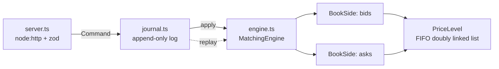

# order-matching-engine

[](https://github.com/wchetz13/order-matching-engine/actions/workflows/ci.yml)


A deterministic limit order book matching engine in TypeScript, the core component of an exchange. It matches buy and sell orders with **price-time priority**, supports **limit, market, IOC, and FOK** orders, and is **event-sourced**: replaying the command journal reproduces every trade and the book state exactly.

It processes about **2.3 million orders per second** on a single core with no runtime dependencies beyond `zod` for input validation.

## Features

- **Matching:** price-time priority. Fills execute at the resting (maker) order's price, and partial fills work across multiple price levels.
- **Order types:**

  | Type      | Remainder after matching         |
  | --------- | -------------------------------- |
  | Limit GTC | Rests on the book                |
  | Limit IOC | Cancelled                        |
  | Limit FOK | Fills completely or does nothing |
  | Market    | Takes liquidity, never rests     |

- **O(1) cancels** from anywhere in a price level's queue, without disturbing the time priority of other orders.
- **Amendments with exchange priority rules:** see [Amending orders](#amending-orders).
- **Exact arithmetic:** prices are integer ticks and quantities are integer lots, so floating-point rounding can never create or destroy quantity.
- **Event stream:** every command returns typed events: `accepted`, `rejected`, `trade`, `rested`, `amended`, `cancelled`, `filled`.
- **Event sourcing:** commands are journaled as newline-delimited JSON. `replay()` rebuilds identical state, which serves as both crash recovery and an audit trail.
- **HTTP API:** built on `node:http` with no framework. Request bodies are size-limited and schema-validated, with clear 400, 404, 413 and 422 semantics.

## Architecture



| Structure        | Representation                                 | Cost                                                                    |
| ---------------- | ---------------------------------------------- | ----------------------------------------------------------------------- |
| Best bid/ask     | Sorted price array, best price stored **last** | O(1) read and remove                                                    |
| New price level  | Binary search + splice                         | O(log L + L), where L is the number of price levels (small in practice) |
| Queue at a price | Doubly linked list                             | O(1) append, pop and cancel                                             |
| Order lookup     | `Map<id, node>`                                | O(1) cancel by id                                                       |

**Why a sorted array instead of a balanced tree for price levels?** Most activity happens within tens to hundreds of levels of the best price. At that size, a contiguous array's cache locality beats pointer-chasing in a red-black tree, and keeping the best price at the end makes the hot path (best price, remove an emptied level) O(1). A tree would only win for books with very many sparse levels; the `BookSide` interface hides the representation, so swapping it wouldn't touch the matching logic.

**Determinism.** The engine reads no clocks and no randomness. Ordering comes from sequence numbers, and trade ids are counters. That's why event sourcing works: the same commands always produce the same events. A property test checks this on randomly generated order flow.

## Amending orders

`engine.amend(orderId, { price?, quantity? })` changes a resting order. `quantity` is the new _open_ quantity. Priority follows the rules most exchanges use:

| Change                      | Queue priority | What happens                                                                   |
| --------------------------- | -------------- | ------------------------------------------------------------------------------ |
| Reduce quantity, same price | **Kept**       | Reduced in place, O(1)                                                         |
| Increase quantity           | Lost           | Moved to the back of its price level                                           |
| Change price                | Lost           | Moved to the new level; trades immediately if the new price crosses the spread |

Reducing to zero isn't an amend (use `cancel`), and an amend that changes nothing is rejected. Each `amended` event records `previousRemaining`, `remaining`, and `priorityKept`, so downstream systems can see exactly what changed.

The randomized property tests mix amendments into the order flow. They caught a real bug while this feature was being built. The journal parser rejected an empty amend, which the engine itself handles (by rejecting it), so a journal containing one couldn't be replayed. The fix keeps the project's rule: schemas validate _shape_, and the engine enforces _business rules_. Anything the engine can receive, the journal can replay.

## Quickstart

```bash
git clone https://github.com/wchetz13/order-matching-engine
cd order-matching-engine
npm ci
npm run check     # typecheck + eslint (strict, type-aware) + prettier + tests with coverage
npm run dev       # start the API on :8080 with reload
```

### As a library

```ts
import { MatchingEngine } from "./dist/index.js"; // after `npm run build`

const engine = new MatchingEngine();
engine.submit({ type: "limit", id: "a", side: "sell", price: 10050, quantity: 10 });
engine.submit({ type: "limit", id: "b", side: "buy", price: 10100, quantity: 4 });
// -> accepted, trade { price: 10050, quantity: 4, maker: "a", taker: "b" }, filled
engine.snapshot(); // { bids: [], asks: [{ price: 10050, quantity: 6, orders: 1 }] }
```

### Over HTTP

```console
$ curl -s -X POST localhost:8080/orders \
    -d '{"type":"limit","id":"b","side":"buy","price":10100,"quantity":4}'
{"events":[{"type":"accepted","orderId":"b","sequence":2},
           {"type":"trade","tradeId":1,"price":10050,"quantity":4,"takerOrderId":"b","makerOrderId":"a","takerSide":"buy"},
           {"type":"filled","orderId":"b"}]}
```

| Method | Path             | Description                                                                             |
| ------ | ---------------- | --------------------------------------------------------------------------------------- |
| GET    | `/health`        | Liveness and open order count                                                           |
| GET    | `/book?depth=10` | Aggregated depth per side (1–100 levels)                                                |
| POST   | `/orders`        | Submit an order. `200`, or `422` if the engine rejects it, or `400` for malformed input |
| PATCH  | `/orders/:id`    | Amend with `{ "price"?, "quantity"? }`. `200`, `404` if unknown, `422` if rejected      |
| DELETE | `/orders/:id`    | Cancel. `200`, or `404` if the order is unknown or already done                         |
| GET    | `/journal`       | The full command log as NDJSON                                                          |

## Testing

51 tests with 100% line and 96% branch coverage. CI enforces minimum coverage thresholds.

- **Scenario tests:**
  - Price priority, then time priority.
  - Execution at the maker's price.
  - Sweeping multiple price levels.
  - IOC and FOK behavior, including FOK leaving the book untouched when it can't fill.
  - Cancelling from the middle of a queue.
  - Amend priority rules, including re-pricing across the spread.
  - Removing a price level once it's empty.
  - Validation and duplicate ids.
- **Property-based tests ([fast-check](https://fast-check.dev)):** these generate random streams of up to 200 mixed orders and cancels, then check that:
  - The book is never crossed (best bid < best ask) after any command.
  - **Quantity is conserved:** for every order, traded + cancelled + resting = submitted + net amended quantity.
  - No trade happens at a price worse than either side's limit.
  - Serializing the journal to JSONL and replaying it reproduces **identical events and the identical book**.
- **HTTP tests:** a real server on an ephemeral port, covering the happy paths, 400, 404, 413 and 422 errors, and journaling.

## Benchmark

`npm run bench` runs 1,000,000 orders with a seeded random generator. The mix is 15% cancels, 5% market orders, and 80% limit orders, about a fifth of which cross the spread.

```
orders:        1,000,000
trades:        343,602
resting:       407,840
elapsed:       0.44 s
throughput:    2,288,954 orders/s
mean latency:  0.44 µs/order
```

Measured on an Apple M5 with Node 26, single-threaded. CI runs a smaller version on every push to catch performance cliffs.

## Tooling

- **TypeScript:** `strict`, plus `noUncheckedIndexedAccess`, `exactOptionalPropertyTypes` and `verbatimModuleSyntax`.
- **Linting:** ESLint with `typescript-eslint` `strictTypeChecked`, and Prettier.
- **Tests:** Vitest with V8 coverage thresholds, and fast-check for property-based tests.
- **CI:** GitHub Actions on Node 22 and 24. Each run type-checks, lints, tests, builds, and runs a benchmark smoke test.

## Project layout

```
src/
  types.ts        order, event, and snapshot types
  priceLevel.ts   FIFO queue at a single price
  bookSide.ts     sorted price levels for one side
  engine.ts       matching logic
  journal.ts      command log + deterministic replay
  schema.ts       wire-format validation (zod)
  server.ts       HTTP API
  main.ts         process entrypoint with graceful shutdown
test/             scenario, property-based, journal, and HTTP tests
bench/            throughput benchmark
```

## License

MIT
